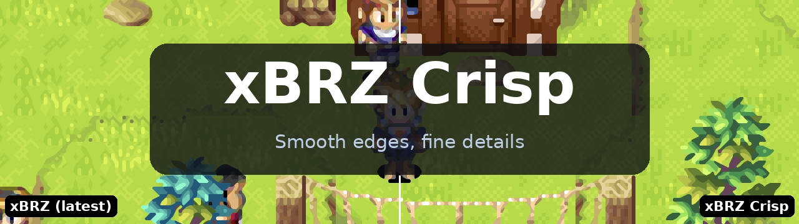
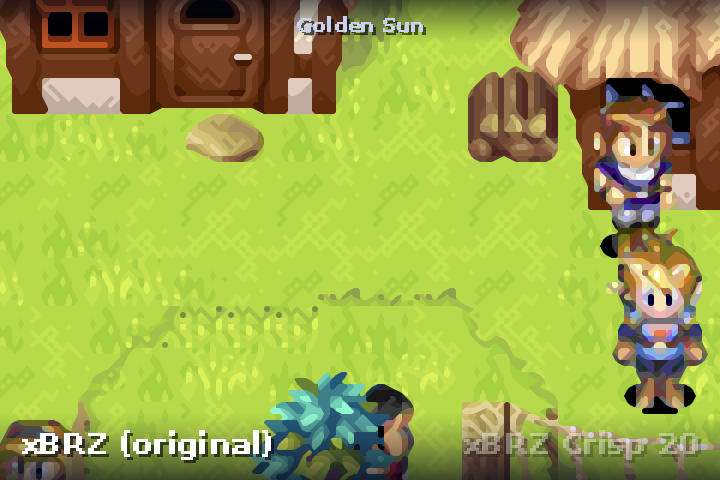
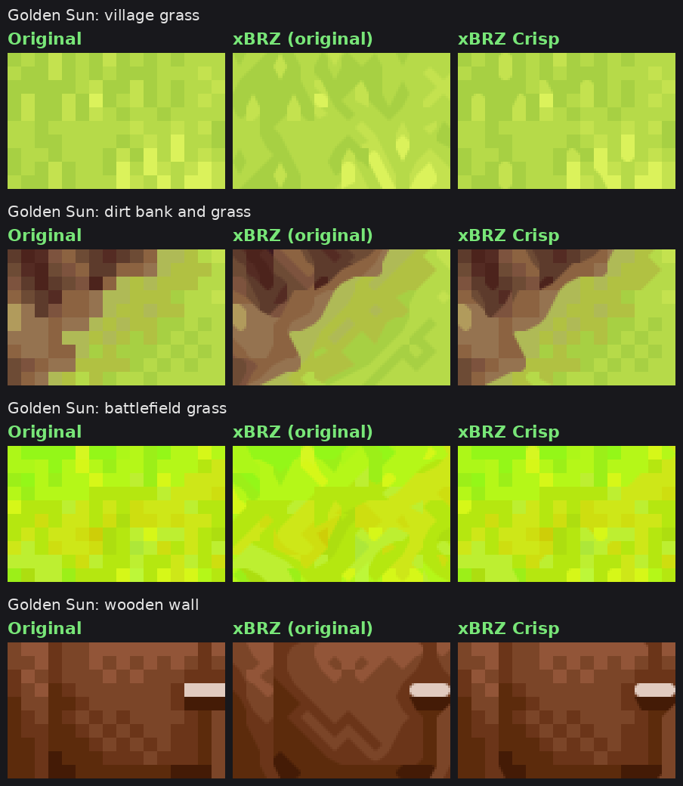
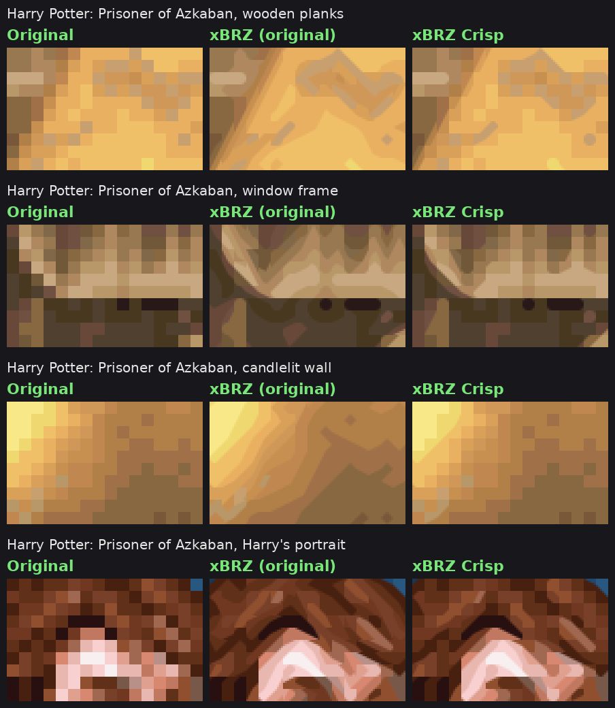
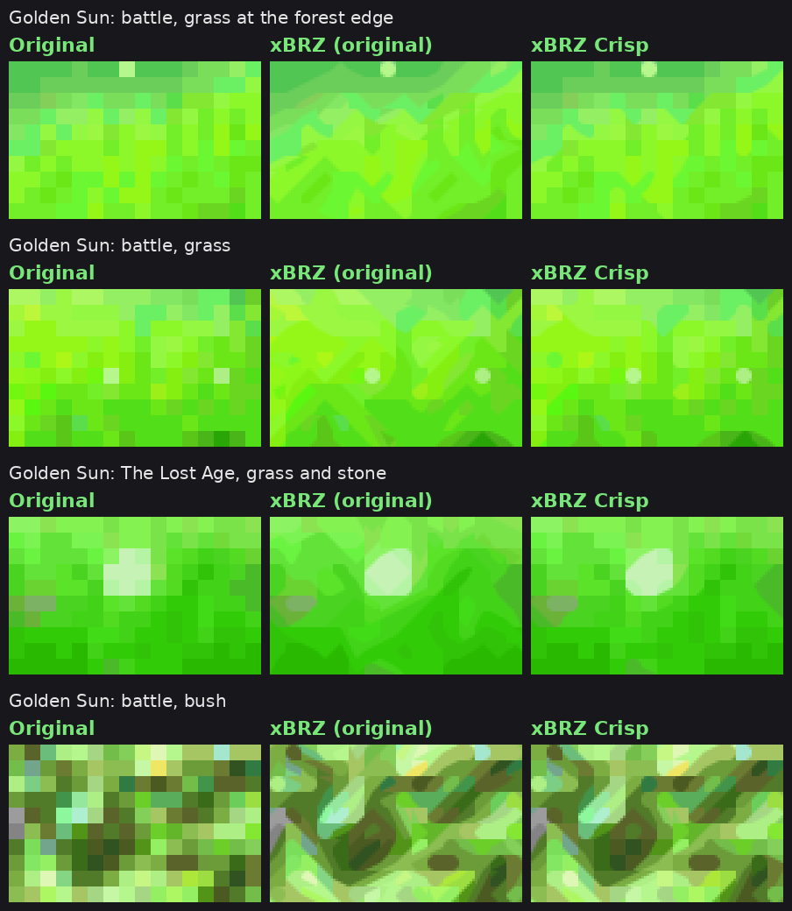
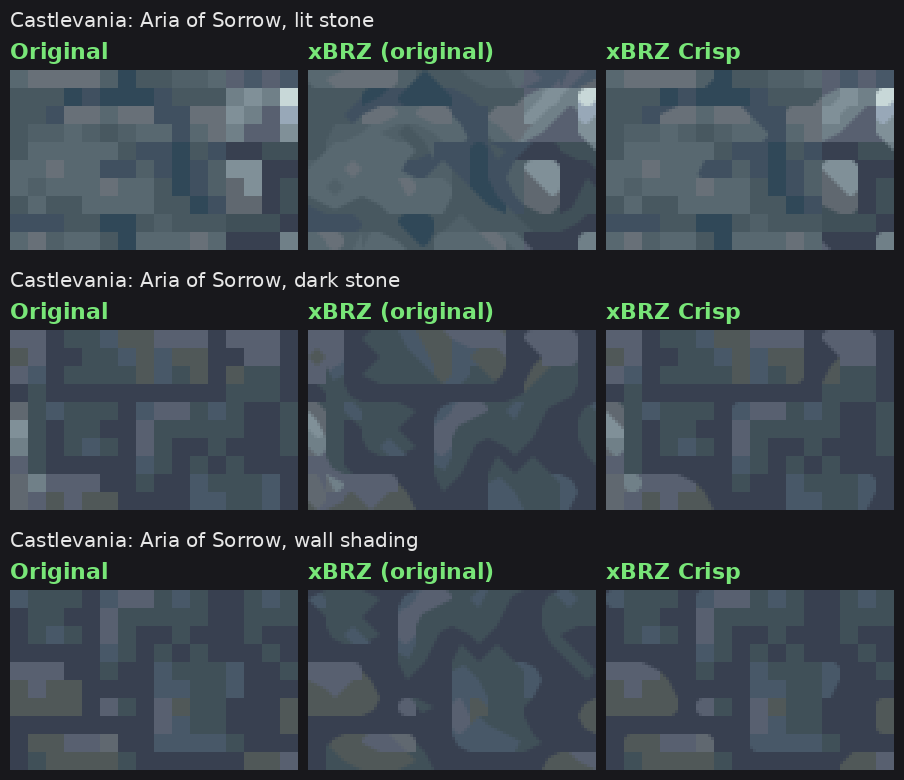
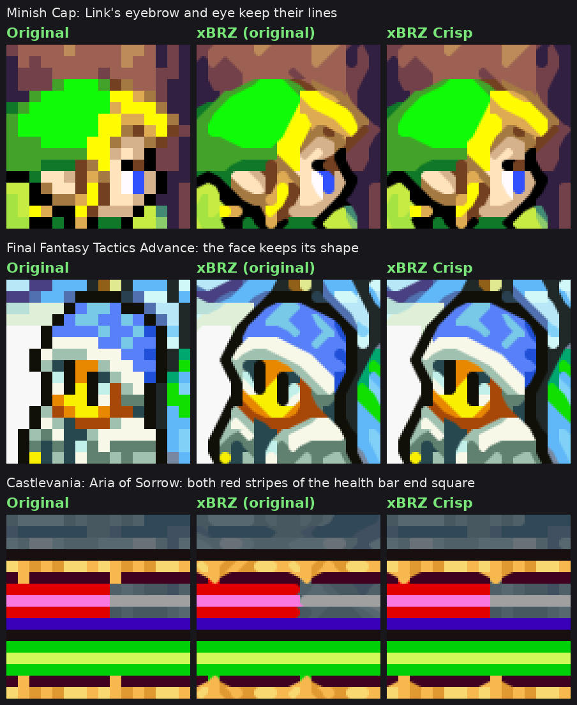
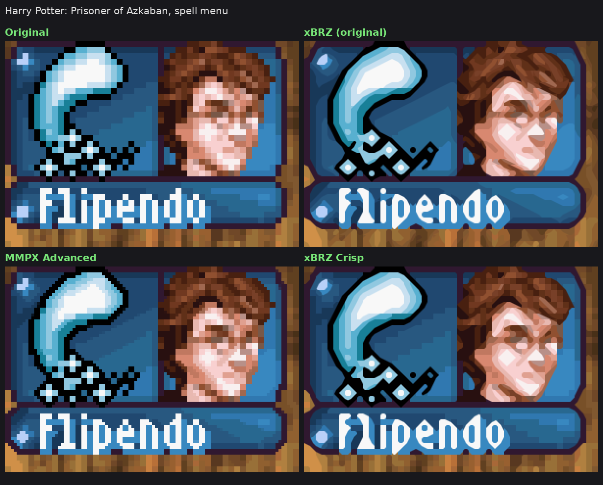
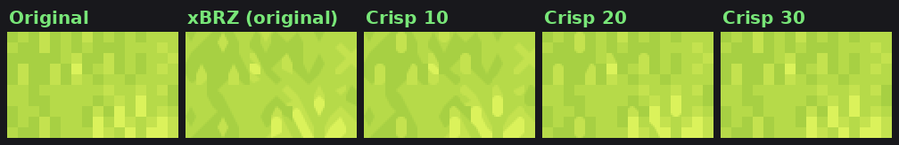
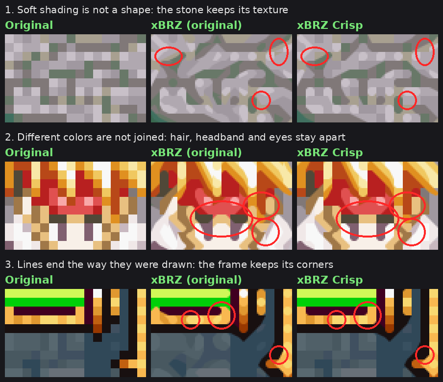

  

  ✨ Outlines and text come out smooth and sharp, just like xBRZ 
  🌿 Grass, foliage, stone and dithering keep their original pixels 
  🙂 Faces and small sprites keep their expression, with no fake diagonals 
  🎮 Ready for RetroArch, in GLSL and slang

<table align="center" width="100%">
  <tr>
    <td align="center" width="33%">🎯 <b>Only clear edges</b> A corner is rounded only when its two colors really differ</td>
    <td align="center" width="33%">🌿 <b>Textures stay intact</b> Soft shading no longer melts into blobs</td>
    <td align="center" width="33%">⚡ <b>Close to libretro xBRZ's cost</b> The extra checks run once per game pixel, not per screen pixel</td>
  </tr>
</table>

> [!NOTE]
> **Which xBRZ?** xBRZ is [Zenju's C++ scaler](https://sourceforge.net/projects/xbrz/). The images here compare xBRZ Crisp with that original, version 1.9 at its default settings, labeled **xBRZ (original)**. xBRZ Crisp is not built on the C++ code: it is a RetroArch shader built on libretro's `xbrz-freescale-multipass`, a separate GLSL and slang shader that follows the xBRZ idea with its own code and thresholds. That libretro shader already includes some of xBRZ Crisp's improvements, and the comparison page shows it too, labeled **xBRZ (libretro)**.

  

<h2 align="center">🎬 Motion Comparison</h2>

<h2 align="center">🌄 Gallery</h2>

<table>
  <tr>
    <td width="50%">
<b>Golden Sun</b>
</td>
    <td width="50%">
<b>Harry Potter: Prisoner of Azkaban</b>
</td>
  </tr>
  <tr>
    <td width="50%">
<b>Golden Sun battles</b>
</td>
    <td width="50%">
<b>Castlevania: Aria of Sorrow</b>
</td>
  </tr>
</table>

More: [other games](comparisons/3-other-games-20.png)

<h2 align="center">🎛️ Presets</h2>

Three presets, from smoothest to closest to the original art. Load one, or change `XBRZ_MINC` in Quick Menu › Shaders › Shader Parameters:

| Preset | `XBRZ_MINC` | Look |
|---|---|---|
| `xbrz-crisp-10` | 10 | The closest to xBRZ. Only the softest shading and dithering keep their pixels, and everything else, including soft edges like the steps of a roof, is smoothed as in xBRZ, still visibly sharper. |
| **`xbrz-crisp`** (default) | **20** | The balance. Grass, foliage and stone keep most of their detail, while outlines, faces, text and most soft diagonals stay smooth. |
| `xbrz-crisp-30` | 30 | The closest to the original art. Textures keep nearly all their pixels, and more soft diagonals turn into steps. |

20 is the default because up to 20 each step keeps more of the original pixels for little loss of smoothness. Past it, smooth antialiased shapes start to lose more.

<h2 align="center">🛠️ Parameters</h2>

Show all shader parameters

| Parameter | Default | What it does |
|---|---|---|
| `XBRZ_MINC` | 20 | Minimum color contrast (x/255) for a corner to be rounded. 0 turns it off. |
| `XBRZ_DIAG` | 100 | Maximum color distance (x/255) between the two colors a cut would join. Above it, the corner stays square. 0 turns it off. |
| `XBRZ_TOL` | 15 | Equal color tolerance. The original C++ xBRZ uses 30. |
| `XBRZ_STEEP` | 3.2 | Steep and shallow line threshold. The original C++ xBRZ uses 2.4 (2.2 before version 1.9), which turns more 1-pixel steps into slopes. |
| `XBRZ_DOM` | 3.8 | Dominant direction threshold. The original C++ xBRZ uses 3.6; 3.8 keeps small corners close to square instead of cutting them into long tips. |

libretro's `xbrz-freescale-multipass` uses the same tolerance, steep and dominant values as xBRZ Crisp, with `XBRZ_MINC` and `XBRZ_DIAG` at 0, so it differs from the original C++ xBRZ in these thresholds as well as in its code.

<h2 align="center">🔬 How it works</h2>

Show how xBRZ Crisp differs from xBRZ

 

The pictures show the original C++ xBRZ. xBRZ Crisp runs the same corner test as xBRZ, with the thresholds listed under Parameters, and then applies the rules below.

xBRZ looks at each corner of each pixel and decides whether to round it. xBRZ Crisp keeps every one of those decisions and only says no when rounding would invent a shape the artist never drew. In that case the corner stays square. The red circles mark where the two differ.

1. 🌿 **Soft shading is not a shape** (`XBRZ_MINC`). When the two colors of a corner are closer than the minimum contrast, they are shading or texture, not an edge, so the corner stays square. A corner just below the limit is still rounded when the corners on both sides of it along the same diagonal are, so a diagonal edge has no tooth where its contrast dips. Where a line crosses an antialiasing pixel on a strong edge, like the edge of a roof in Golden Sun, both halves of the pixel are cut as in xBRZ, so the pixel becomes part of the diagonal instead of a notch in it. A long straight line between two stripes, like the antialiasing band along an outline, keeps every corner cut even where its contrast is low, so it has no teeth.
2. 🎨 **Different colors are not joined** (`XBRZ_DIAG`). Rounding a corner joins the two neighbors on its diagonal. When those are very different colors, the corner is a meeting point, not a line, so it stays square. Dark outlines, eyes and eyebrows keep their full shape. Where the artist stepped an antialiasing pixel along a diagonal edge, like the shaded edge of a cape, the corner is rounded as in xBRZ. The same goes for the tip of a diagonal that ends on a straight edge, like a lock of Link's hair.
3. 📏 **Lines end the way they were drawn.** Straight lines do not bend where they meet, stacked stripes end square (unless a line meets their end), and diagonal lines run on to their end or up to the outline. A 45-degree diagonal the artist drew, like a lock of hair, and thin light strokes, like the white strokes of letters, are rounded as in xBRZ. A dark shadow that runs under a character's feet closes around them on any floor, flat or textured, and a row of 1-pixel tiles between two walls, like the squares of a gauge, keeps its tiles square.
4. 📐 **Steps are drawn straight.** xBRZ only draws 45-degree and 2:1 lines. Where an edge climbs in regular steps of 2 to 6 pixels, like the italic letters of Golden Sun, a rail or the edge of a roof, the cut follows the steps' own slope, so both sides of a stroke run parallel and the line does not bend at every step. A letter's dark shadow runs parallel to its letter. Curves, irregular steps and low-contrast edges keep xBRZ's lines.

Edges are still found with xBRZ's own test, so outlines and text are smoothed as before. The diagonal check is inspired by [cleanEdge](https://github.com/libretro/slang-shaders/tree/master/edge-smoothing/cleanEdge) by torcado. The [comparison page](https://ele3131.github.io/xBRZ-Crisp/#how) goes through every rule with more examples.

Port details and testing

xBRZ Crisp started as a set of fixes to libretro's `xbrz-freescale-multipass`, a shader written for RetroArch separately from [Zenju's C++ xBRZ](https://sourceforge.net/projects/xbrz/), and most of its code has been rewritten since. Blend color ties and the order of the four corners were changed to follow the C++ xBRZ, the GLSL version takes the output scale from the image size instead of the texture size, and the output pass reads the image from the pass before xBRZ, so it also works after other shaders in a preset (a color correction, for example). It runs in three passes: the first decides every corner once per game pixel, a resolve pass settles the decisions that depend on the neighbors, also once per game pixel, and the output pass only draws the corners.

The code is shared with plain `xbrz-freescale-multipass`: `tools/make-multipass.py` writes it from these files, with its own title and `XBRZ_MINC` at 0, so it keeps rules 2 and 4 to 7, the ones that fix clear xBRZ errors; the other rules are the crisp look and run only with `XBRZ_MINC` above 0. Each file starts with a numbered list of the rules, and each rule has its own section with the same number in the code.

Tested in RetroArch on Android (gl driver, Game Boy Advance at 6x). The slang version was compiled to SPIR-V with glslang and renders the same output as the GLSL version in an offline harness.

<h2 align="center">💾 Install</h2>

> [!TIP]
> Get the latest zip from **[Releases](https://github.com/ele3131/xbrz-crisp/releases)**.

1. Copy the zip's contents into RetroArch's shader folder: `shaders_slang` for Vulkan, glcore, D3D and Metal, `shaders_glsl` for the gl driver.
2. In a game, open Quick Menu › Shaders › Load and pick `edge-smoothing/xbrz/xbrz-crisp.slangp` (slang) or `xbrz/xbrz-crisp.glslp` (glsl). Use `xbrz-crisp-10` or `xbrz-crisp-30` for the other presets.
3. Save it with Quick Menu › Shaders › Save › Save Global Preset, or per game with Save Game Preset.

<h2 align="center">🤝 Giving back to libretro</h2>

Part of xBRZ Crisp is now in libretro's xBRZ shader. Starting with our first pull request on October 20, 2026, libretro's `xbrz-freescale-multipass` has taken in its port fixes, tuned thresholds and lighter output pass, plus the `xbrz-crisp` preset ([glsl #576](https://github.com/libretro/glsl-shaders/pull/576), [#577](https://github.com/libretro/glsl-shaders/pull/577), [slang #971](https://github.com/libretro/slang-shaders/pull/971), [#973](https://github.com/libretro/slang-shaders/pull/973)). None of these changes are in the original C++ xBRZ. The comparison page shows this libretro version as xBRZ (libretro), next to the original.

<h2 align="center">⚖️ License</h2>

xBRZ is © Zenju, who wrote the [original C++ version](https://sourceforge.net/projects/xbrz/), and is distributed under the GNU General Public License v3; libretro's shader and xBRZ Crisp keep that license, as noted in the shader headers. Hyllian's xBR vertex code and texel mapping are under the MIT-style license included there. The similar diagonal check is inspired by torcado's cleanEdge (MIT license); no cleanEdge code is included.

Developed with the help of Claude (Anthropic).
