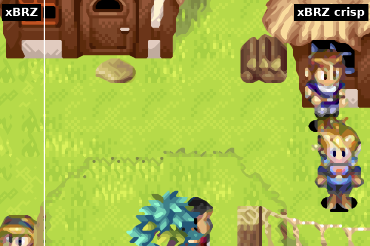
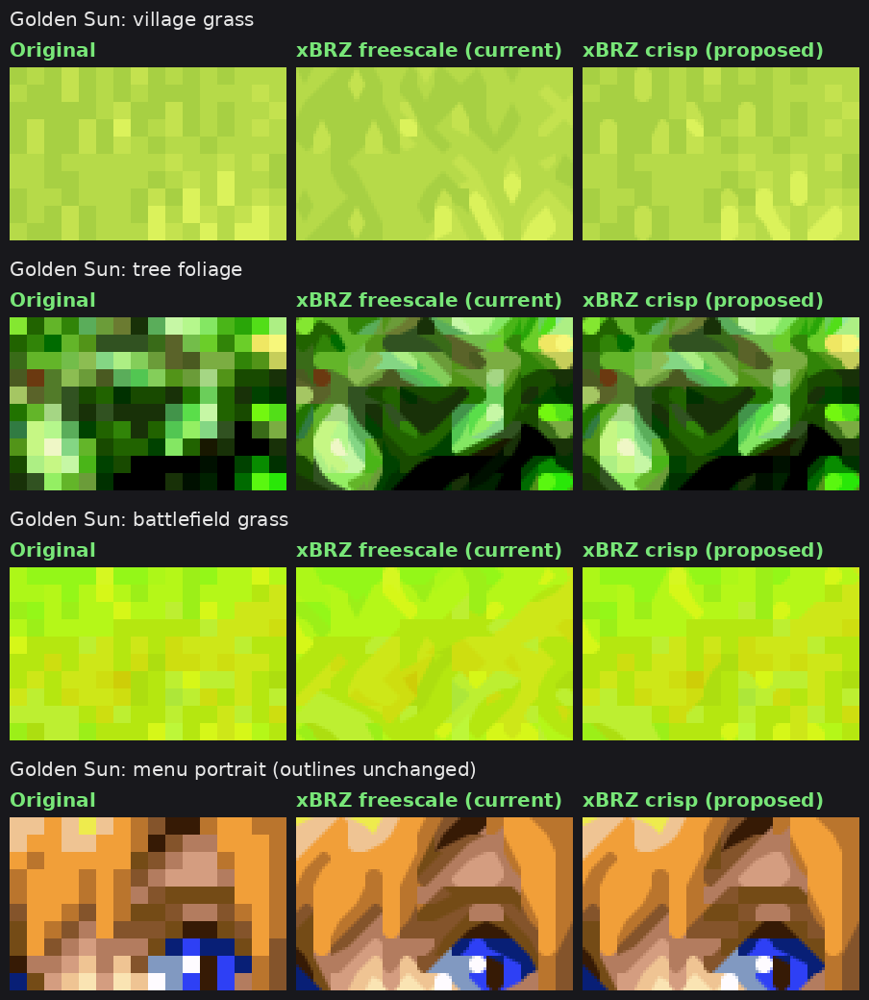
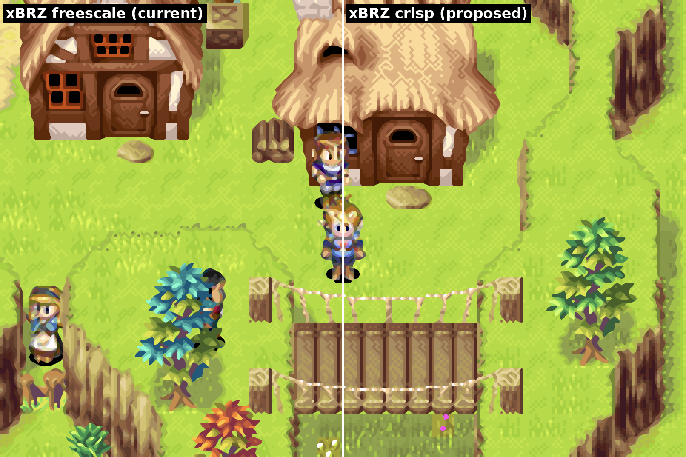

# xBRZ crisp

An xBRZ shader for RetroArch that only rounds corners between clearly different colors. Outlines, text and sprites are smoothed as in xBRZ, while low-contrast shading and textures (grass, foliage, stone, dithering) keep their pixel detail instead of melting into blobs.

## [▶ Open the interactive comparison](https://ele3131.github.io/xbrz-crisp/)

Drag the line between xBRZ and xBRZ crisp on 9 Game Boy Advance scenes, compare minimum contrast 16, 24 and 32, and zoom in up to 3×.

More: [other games](comparisons/3-other-games.png) · [Minish Cap](comparisons/2-minish-cap.png) · [Golden Sun battle](comparisons/split-gs_battle.png) · [Castlevania](comparisons/split-cv_aria.png)

## Presets

There is one preset, `xbrz-crisp`, with a minimum contrast of 16. For a sharper look, raise `XBRZ_MINC` in Quick Menu › Shaders › Shader Parameters and save the preset. Good steps:

| `XBRZ_MINC` | Look |
|---|---|
| 16 (default) | Textures stop melting, soft shadows and faces stay like xBRZ. |
| 24 | More texture detail in grass and foliage. Some soft diagonals turn into steps. |
| 32 | Sharpest. Pale skin and soft shadows can start to look blocky. |

The cost is the same as `xbrz-freescale-multipass` at any value.

## Install

1. Download [xbrz-crisp-v1.0.zip](https://github.com/ele3131/xbrz-crisp/releases/latest/download/xbrz-crisp-v1.0.zip) from [Releases](https://github.com/ele3131/xbrz-crisp/releases) (or use the `shaders/` folder of this repository) and copy its contents into RetroArch's shader folder: `shaders_slang` is for the Vulkan, glcore, D3D and Metal drivers, `shaders_glsl` is for the gl driver.
2. In a game, open Quick Menu › Shaders › Load and pick `edge-smoothing/xbrz/xbrz-crisp.slangp` (slang) or `xbrz/xbrz-crisp.glslp` (glsl).
3. Save it with Quick Menu › Shaders › Save › Save Global Preset, or per game with Save Game Preset.

## Parameters

| Parameter | Default | What it does |
|---|---|---|
| `XBRZ_MINC` | 16 | Minimum color contrast (x/255) for a corner to be rounded. 0 turns it off (the tolerance and steep thresholds below still apply). |
| `XBRZ_MINC_RAMP` | 0 | Width of a soft transition around the threshold, so corners shrink gradually. 0 is a hard cut. |
| `XBRZ_TOL` | 15 | Equal color tolerance. Stock xBRZ uses 30. |
| `XBRZ_STEEP` | 3.0 | Steep and shallow line threshold. Stock xBRZ uses 2.2, which turns 1-pixel steps into slopes. |
| `XBRZ_DOM` | 3.6 | Dominant direction threshold. |
| `XBRZ_LUMA` | 1.0 | Weight of brightness against color in the comparisons. |

## How it works

xBRZ decides corner by corner whether to cut a pixel's corner with a neighbor's color. xBRZ crisp keeps that decision and adds one check before drawing: if the pixel and the blend color are closer than `XBRZ_MINC` (YCbCr distance), the corner stays square. Edge detection is unchanged, so only the low-contrast blends are skipped.

The shader is based on the libretro `xbrz-freescale-multipass` port. A few details were aligned with the reference C++ xBRZ: blend color ties and the order of the four corners follow the original, and the GLSL version takes the output scale from the image size instead of the texture size.

Tested in RetroArch on Android (gl driver, Game Boy Advance at 6x). The slang version was compiled to SPIR-V with glslang and renders the same output as the GLSL version in an offline harness.

## License

xBRZ is © Zenju and distributed under the GNU General Public License v3, as noted in the shader headers. Hyllian's xBR vertex code and texel mapping are under the MIT-style license included there.

Developed with the help of Claude (Anthropic).
