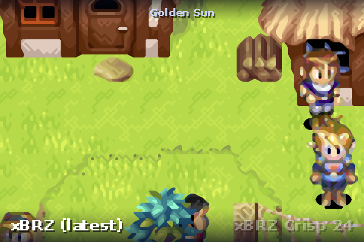
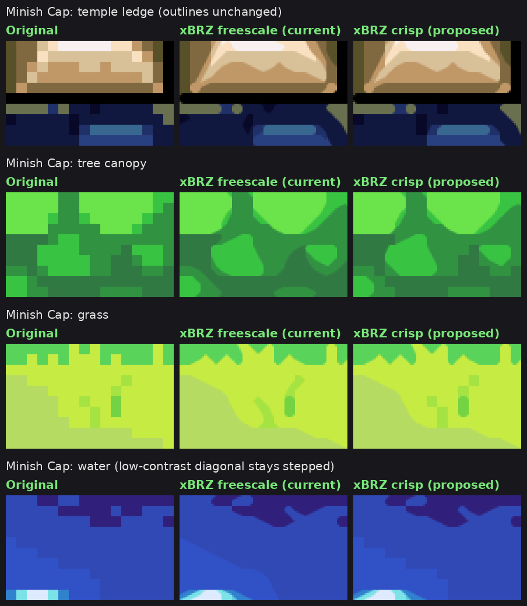
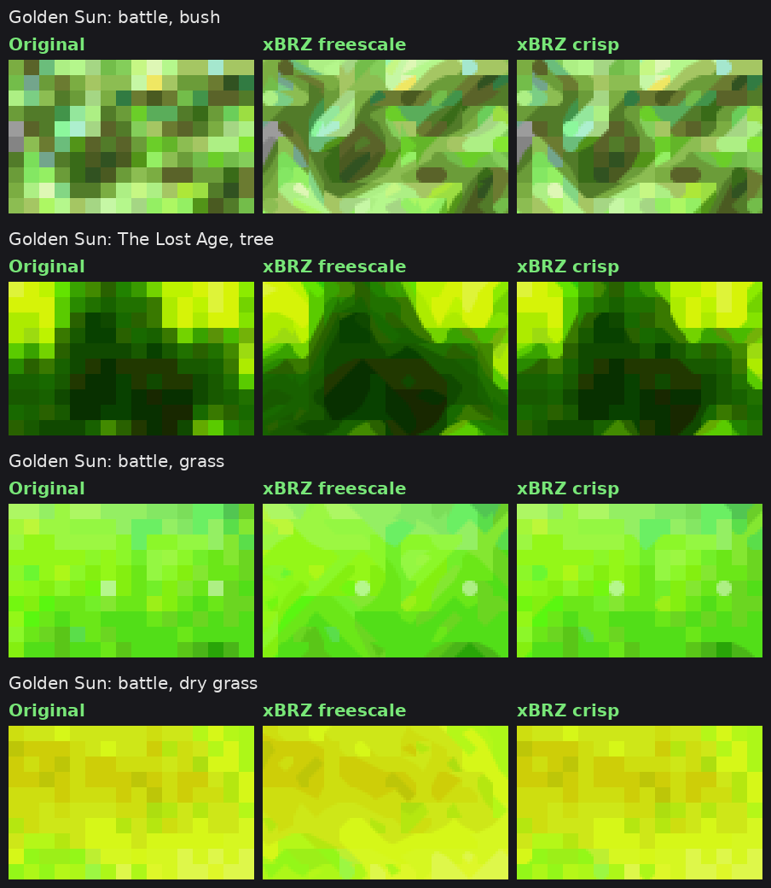
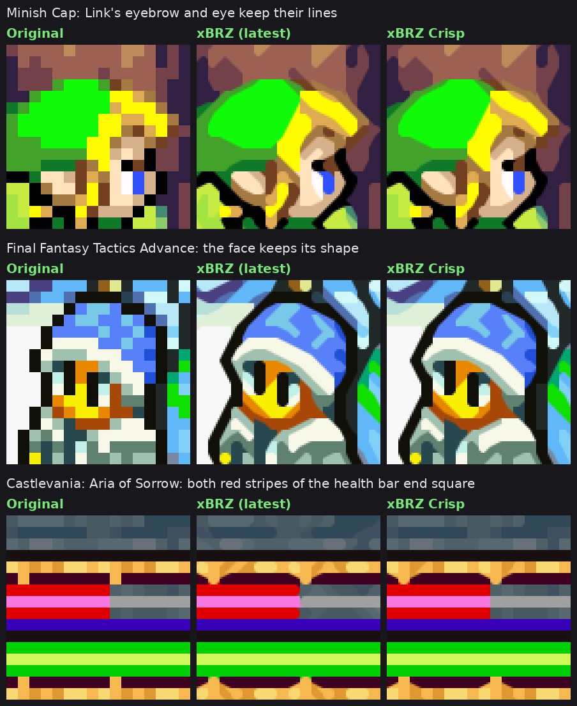

  

  <b>The smoothness of xBRZ, with respect for every pixel the artist drew.</b>  
  ✨ Outlines and text come out smooth and sharp, just like xBRZ 
  🌿 Grass, foliage, stone and dithering keep their original pixels 
  🙂 Faces and small sprites keep their expression, with no fake diagonals 
  🎮 Ready for RetroArch, in GLSL and slang

  

<table align="center" width="100%">
  <tr>
    <td align="center" width="33%">🎯 <b>Only clear edges</b> A corner is rounded only when its two colors really differ</td>
    <td align="center" width="33%">🌿 <b>Textures stay intact</b> Soft shading no longer melts into blobs</td>
    <td align="center" width="33%">⚡ <b>Same cost</b> Runs like xbrz-freescale-multipass</td>
  </tr>
</table>

<h2 align="center">🎬 Interactive Comparison</h2>

Pick integer scaling, MMPX Advanced, ScaleFX, xBRZ (latest) or xBRZ Crisp (contrast 12 to 30) on each side, drag the line across 10 Game Boy Advance scenes, zoom in up to 4×, hold a button to see the original pixels, and mark in red every spot where the two sides differ.

<h2 align="center">🌄 Gallery</h2>

<table>
  <tr>
    <td width="50%">
<b>Golden Sun</b>
</td>
    <td width="50%">
<b>The Minish Cap</b>
</td>
  </tr>
  <tr>
    <td width="50%">
<b>Golden Sun battles</b>
</td>
    <td width="50%">
<b>Castlevania: Aria of Sorrow</b>
</td>
  </tr>
</table>

Faces keep their expression. Since 1.4, a corner where three different colors meet is no longer cut into a fake diagonal, so Link's eyebrow stays straight instead of being pulled into his eye, and stacked stripes such as health bars end square:

Text and portraits keep their shape too, as in the spell menu of Harry Potter: Prisoner of Azkaban:

More: [other games](comparisons/3-other-games-24.png)

<h2 align="center">🎛️ Presets</h2>

One preset, `xbrz-crisp`, with a minimum contrast of 24. Change `XBRZ_MINC` in Quick Menu › Shaders › Shader Parameters and save the preset to pick another look:

| `XBRZ_MINC` | Look |
|---|---|
| **12** | xBRZ with light improvements: only the softest shading and textures keep their pixels. |
| **16** | Textures and soft shading keep their pixels, while outlines, faces and text are smoothed as in xBRZ. |
| **24** (default) | Grass, foliage and textures keep most of their pixel detail, the closest to the original art, while outlines, faces and text are still smoothed. Some soft diagonals turn into steps. |

24 is the default: up to 24, each step keeps more of the original pixels for little loss of smoothness, and past it the same gain costs two to three times more.

<h2 align="center">🛠️ Parameters</h2>

Show all shader parameters

| Parameter | Default | What it does |
|---|---|---|
| `XBRZ_MINC` | 24 | Minimum color contrast (x/255) for a corner to be rounded. 0 turns it off. |
| `XBRZ_DIAG` | 100 | Maximum color distance (x/255) between the two colors a cut would join. Above it, the corner stays square. 0 turns it off. |
| `XBRZ_TOL` | 15 | Equal color tolerance. The reference C++ xBRZ uses 30. |
| `XBRZ_STEEP` | 3.2 | Steep and shallow line threshold. The reference C++ xBRZ uses 2.2, which turns 1-pixel steps into slopes. |
| `XBRZ_DOM` | 3.8 | Dominant direction threshold. The reference C++ xBRZ uses 3.6; 3.8 keeps small corners close to square instead of cutting them into long tips. |

libretro's `xbrz-freescale-multipass` uses the same tolerance, steep and dominant values, with `XBRZ_MINC` and `XBRZ_DIAG` at 0.

<h2 align="center">🔬 How it works</h2>

xBRZ decides corner by corner whether to cut a pixel's corner with a neighbor's color. xBRZ crisp keeps that decision and adds two checks before drawing:

1. **Minimum contrast.** If the pixel and the blend color are closer than `XBRZ_MINC` (YCbCr distance), the corner stays square, so soft shading and textures keep their pixels.
2. **Similar diagonal.** A cut joins the two neighbors on the corner's diagonal. If those two colors differ by more than `XBRZ_DIAG`, the corner is a junction of different colors, not a diagonal line, and it stays square. Antialiasing ramps, where one of the two colors sits between the pixel and the other one, use a limit of 92. Corners that are part of a shallow or steep line are not blocked, unless the line would cut a pixel with a lighter color: dark outlines, eyes and eyebrows keep their whole pixel, since the eye reads dark lines as the shape. A blocked corner is still cut when the next corner along the same diagonal is cut, so lines are drawn to the end, and at the tip of a 1-pixel diagonal stripe, so the stripe runs on to the edge. Between two close inner tones, the cut also runs up to an outline darker than both, so the line reaches the outline and the outline stays whole; this is skipped at the corner of a solid block, along 1-pixel stripes and next to a corner the artist already rounded with an antialiasing pixel, as in the numbers of a HUD. A corner whose blend color runs straight on, like a frame or a horizontal line, stays square, so lines do not bend where they meet. Where two dark strokes of different colors meet in an L around a 1-pixel light gap, like a pupil under an eyebrow, the corner stays square, so the two are not joined into a diagonal. Where stacked 1-pixel stripes end flush, as in health bars, the end corners stay square when their diagonal colors differ by more than 64, so every stripe ends the same way.

Edge detection is the same as in xBRZ, except that the shallow and steep line tests weigh hue a little more than lightness (1.2x), so lines in shading that shifts hue, from orange to yellow for example, follow the artist's pixels. Shapes are otherwise found exactly as before and only these blends are skipped. The idea of only joining colors that match along the diagonal comes from [cleanEdge](https://github.com/libretro/slang-shaders/tree/master/edge-smoothing/cleanEdge) by torcado.

Port details and testing

The shader is based on the libretro `xbrz-freescale-multipass` port. Blend color ties and the order of the four corners follow the reference C++ xBRZ, the GLSL version takes the output scale from the image size instead of the texture size, and the output pass reads the image from the pass before xBRZ, so it also works after other shaders in a preset (a color correction, for example).

The code keeps the xBRZ part and the crisp rules apart: the crisp rules sit between `//#crisp{` and `//#crisp}` markers, and `tools/make-multipass.py` removes them to write plain `xbrz-freescale-multipass`.

Tested in RetroArch on Android (gl driver, Game Boy Advance at 6x). The slang version was compiled to SPIR-V with glslang and renders the same output as the GLSL version in an offline harness.

<h2 align="center">💾 Install</h2>

> [!TIP]
> Get the latest zip from **[Releases](https://github.com/ele3131/xbrz-crisp/releases)**.

1. Copy the zip's contents into RetroArch's shader folder: `shaders_slang` for Vulkan, glcore, D3D and Metal, `shaders_glsl` for the gl driver.
2. In a game, open Quick Menu › Shaders › Load and pick `edge-smoothing/xbrz/xbrz-crisp.slangp` (slang) or `xbrz/xbrz-crisp.glslp` (glsl).
3. Save it with Quick Menu › Shaders › Save › Save Global Preset, or per game with Save Game Preset.

<h2 align="center">🤝 Giving back to xBRZ</h2>

Part of xBRZ Crisp is now in xBRZ itself. Starting with our first pull request on October 20, 2026, libretro's `xbrz-freescale-multipass` has taken in its port fixes, tuned thresholds and lighter output pass, plus the `xbrz-crisp` preset ([glsl #576](https://github.com/libretro/glsl-shaders/pull/576), [#577](https://github.com/libretro/glsl-shaders/pull/577), [slang #971](https://github.com/libretro/slang-shaders/pull/971), [#973](https://github.com/libretro/slang-shaders/pull/973)). The comparisons here use that improved version, labeled xBRZ (latest).

<h2 align="center">⚖️ License</h2>

xBRZ is © Zenju and distributed under the GNU General Public License v3, as noted in the shader headers. Hyllian's xBR vertex code and texel mapping are under the MIT-style license included there. The similar diagonal check is inspired by torcado's cleanEdge (MIT license); no cleanEdge code is included.

Developed with the help of Claude (Anthropic).
