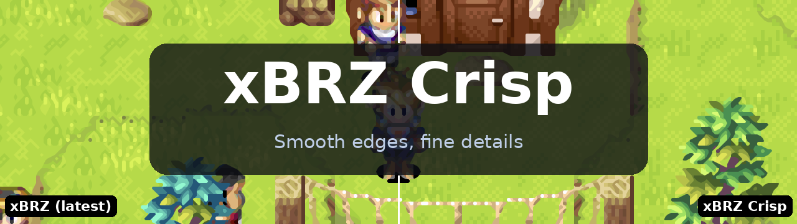
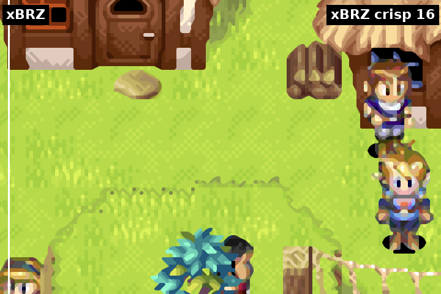
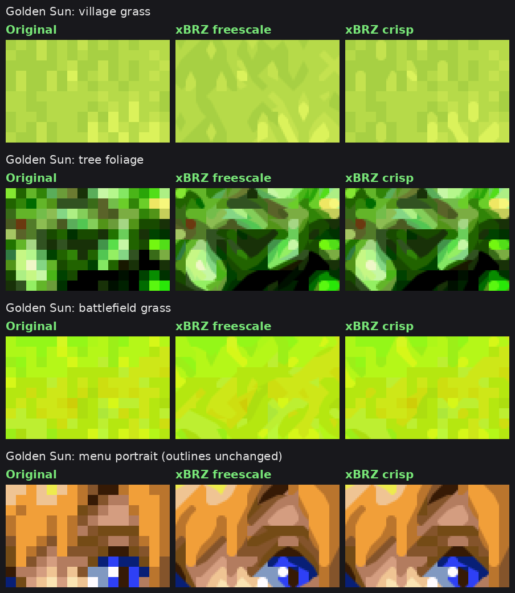
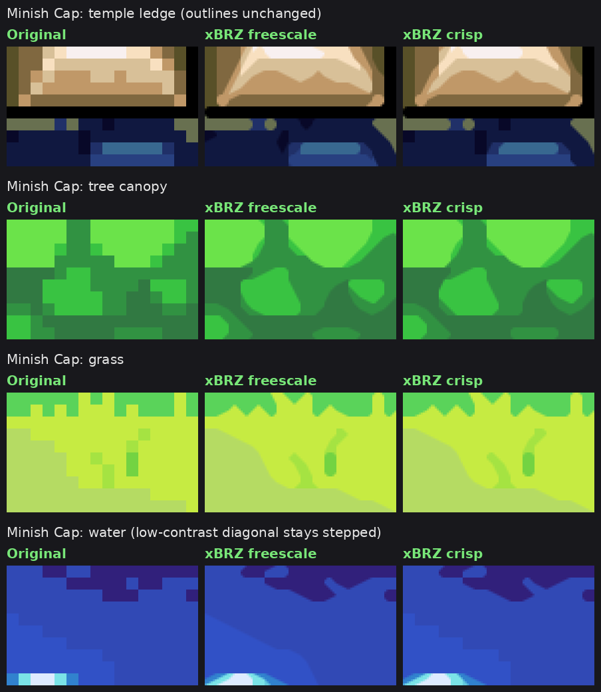
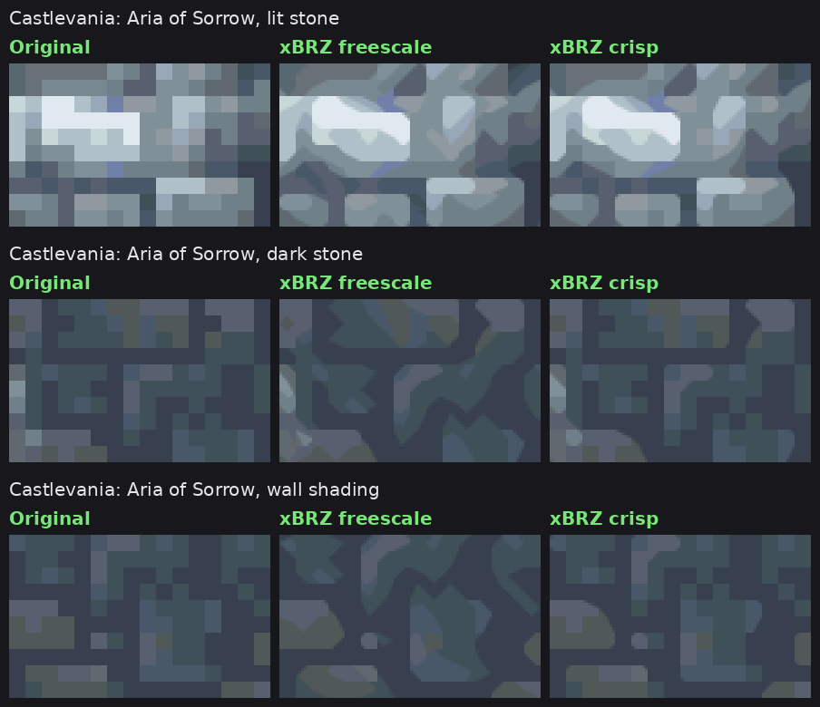
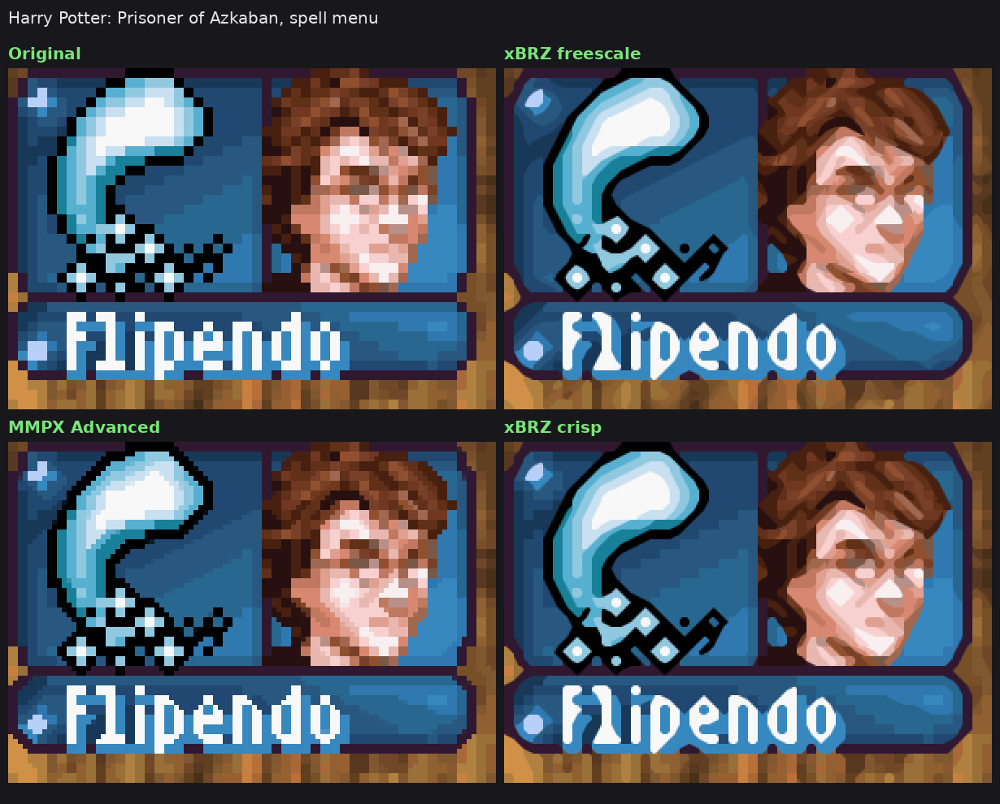
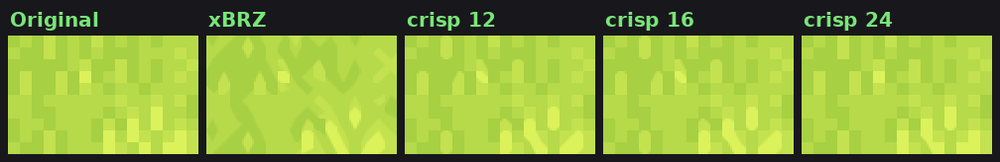

  

  An xBRZ shader for RetroArch that only rounds corners between clearly different colors. 
  Outlines and text are smoothed as in xBRZ. Grass, foliage, stone and dithering keep the pixels the artist drew.

  

<table>
  <tr>
    <td align="center" width="33%">🎯 <b>Only clear edges</b> A corner is rounded only when its two colors really differ</td>
    <td align="center" width="33%">🌿 <b>Textures stay intact</b> Soft shading no longer melts into blobs</td>
    <td align="center" width="33%">⚡ <b>Same cost</b> Runs like xbrz-freescale-multipass</td>
  </tr>
</table>

## 🎬 Interactive Comparison

Pick integer scaling, xBRZ, MMPX Advanced or xBRZ Crisp (contrast 12 to 30) on each side, drag the line across 10 Game Boy Advance scenes, zoom in up to 3×, and mark in red every spot where the two sides differ.

## 🌄 Gallery

<table>
  <tr>
    <td width="50%">
<b>Golden Sun</b>
</td>
    <td width="50%">
<b>The Minish Cap</b>
</td>
  </tr>
  <tr>
    <td width="50%">
<b>Golden Sun battles</b>
</td>
    <td width="50%">
<b>Castlevania: Aria of Sorrow</b>
</td>
  </tr>
</table>

Text and portraits keep their shape too, as in the spell menu of Harry Potter: Prisoner of Azkaban:

More: [other games](comparisons/3-other-games-16.png)

## 🎛️ Presets

One preset, `xbrz-crisp`, with a minimum contrast of 16. Change `XBRZ_MINC` in Quick Menu › Shaders › Shader Parameters and save the preset to pick another look:

| `XBRZ_MINC` | Look |
|---|---|
| **12** | Closest to xBRZ, with a light gain in detail. |
| **16** (default) | Textures and soft shading keep their pixels, while outlines, faces and text are smoothed as in xBRZ. |
| **24** | More texture detail in grass and foliage, closer to the original art. Some soft diagonals turn into steps. |

## 🛠️ Parameters

Show all shader parameters

| Parameter | Default | What it does |
|---|---|---|
| `XBRZ_MINC` | 16 | Minimum color contrast (x/255) for a corner to be rounded. 0 turns it off. |
| `XBRZ_MINC_RAMP` | 0 | Width of a soft transition around the threshold. 0 is a hard cut. |
| `XBRZ_TOL` | 15 | Equal color tolerance. Stock xBRZ uses 30. |
| `XBRZ_STEEP` | 3.2 | Steep and shallow line threshold. Stock xBRZ uses 2.2, which turns 1-pixel steps into slopes. |
| `XBRZ_DOM` | 3.75 | Dominant direction threshold. Stock xBRZ uses 3.6; 3.75 cuts fewer curve tips. |
| `XBRZ_LUMA` | 1.0 | Weight of brightness against color in the comparisons. |

## 🔬 How it works

xBRZ decides corner by corner whether to cut a pixel's corner with a neighbor's color. xBRZ crisp keeps that decision and adds one check before drawing: if the pixel and the blend color are closer than `XBRZ_MINC` (YCbCr distance), the corner stays square. Edge detection is unchanged, so only the low-contrast blends are skipped.

Port details and testing

The shader is based on the libretro `xbrz-freescale-multipass` port. Blend color ties and the order of the four corners follow the reference C++ xBRZ, and the GLSL version takes the output scale from the image size instead of the texture size.

Tested in RetroArch on Android (gl driver, Game Boy Advance at 6x). The slang version was compiled to SPIR-V with glslang and renders the same output as the GLSL version in an offline harness.

## 💾 Install

> [!TIP]
> Get the latest zip from **[Releases](https://github.com/ele3131/xbrz-crisp/releases)**.

1. Copy the zip's contents into RetroArch's shader folder: `shaders_slang` for Vulkan, glcore, D3D and Metal, `shaders_glsl` for the gl driver.
2. In a game, open Quick Menu › Shaders › Load and pick `edge-smoothing/xbrz/xbrz-crisp.slangp` (slang) or `xbrz/xbrz-crisp.glslp` (glsl).
3. Save it with Quick Menu › Shaders › Save › Save Global Preset, or per game with Save Game Preset.

## ⚖️ License

xBRZ is © Zenju and distributed under the GNU General Public License v3, as noted in the shader headers. Hyllian's xBR vertex code and texel mapping are under the MIT-style license included there.

Developed with the help of Claude (Anthropic).
