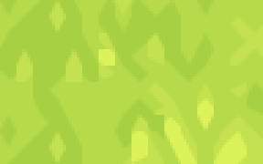
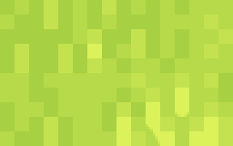
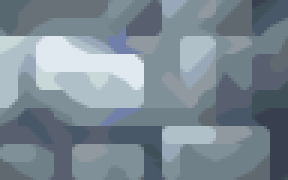
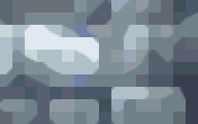
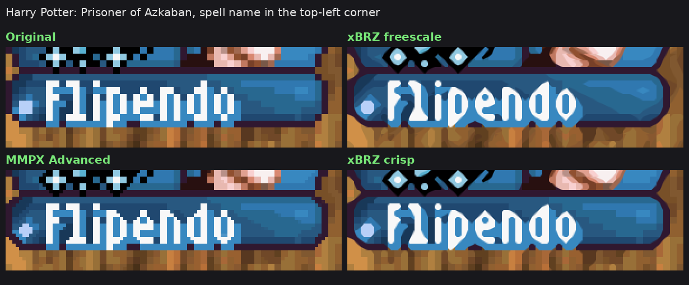
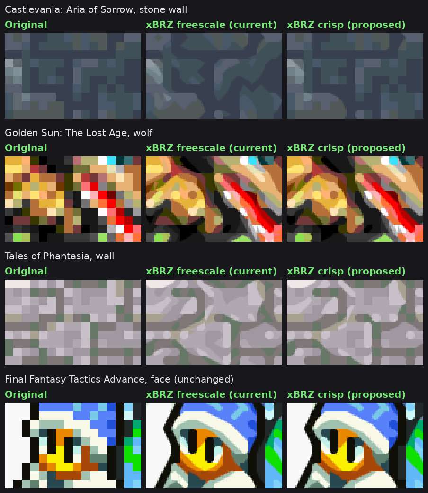

# 💠 xBRZ crisp

> An xBRZ shader for RetroArch that rounds what should be round and leaves the rest pixel-true.

**Jump to:** [Why](#why) · [Interactive Comparison](#comparison) · [Examples](#examples) · [Presets](#presets) · [Parameters](#parameters) · [How it works](#how) · [Install](#install) · [FAQ](#faq)

## 💡 Why

xBRZ smooths every corner it finds, so grass, stone and soft shading melt into blobs. xBRZ crisp only rounds a corner when its two colors are clearly different.

| | xBRZ | xBRZ crisp |
|:--|:--:|:--:|
| **Grass** · Golden Sun |  |  |
| **Tree canopy** · Minish Cap |  |  |
| **Stone** · Castlevania |  |  |

## 🧪 Interactive Comparison

> [!TIP]
> **[Open the Interactive Comparison →](https://ele3131.github.io/xbrz-crisp/)**
> Drag the line between xBRZ crisp and xBRZ, integer scaling or MMPX Advanced on 10 Game Boy Advance scenes, compare contrast 12, 24 and 32, zoom in up to 3×, and mark every spot crisp changes.

## 🗂️ Examples

<b>Text:</b> Harry Potter: Prisoner of Azkaban spell name

<b>More games:</b> Minish Cap, Golden Sun battles, Castlevania and others

## 🪄 Presets

There is one preset, `xbrz-crisp`, with a minimum contrast of 24. To change it, set `XBRZ_MINC` in Quick Menu › Shaders › Shader Parameters and save the preset.

| `XBRZ_MINC` | Best for |
|---|---|
| 12 | A light touch: closest to xBRZ, with a little more detail. |
| 24 (default) | Textures closest to the original art. Some soft diagonals turn into steps. |
| 32 | Maximum sharpness. Pale skin and soft shadows can start to look blocky. |

The cost is the same as `xbrz-freescale-multipass` at any value.

## 🔧 Parameters

| Parameter | Default | Stock xBRZ | What it does |
|---|:-:|:-:|---|
| `XBRZ_MINC` | 24 | – | Minimum color contrast (x/255) for a corner to be rounded. 0 turns it off. |
| `XBRZ_MINC_RAMP` | 0 | – | Width of a soft transition around the threshold. 0 is a hard cut. |
| `XBRZ_TOL` | 15 | 30 | Equal color tolerance. |
| `XBRZ_STEEP` | 3.2 | 2.2 | Steep and shallow line threshold. Higher keeps 1-pixel steps as steps. |
| `XBRZ_DOM` | 3.8 | 3.6 | Dominant direction threshold. Higher cuts fewer curve tips. |
| `XBRZ_LUMA` | 1.0 | 1.0 | Weight of brightness against color in the comparisons. |

## 🧩 How it works

xBRZ decides corner by corner whether to cut a pixel's corner with a neighbor's color. xBRZ crisp keeps that decision and adds one check before drawing: if the pixel and the blend color are closer than `XBRZ_MINC` (YCbCr distance), the corner stays square. Edge detection is unchanged, so only the low-contrast blends are skipped.

The shader is based on the libretro `xbrz-freescale-multipass` port, with blend color ties and corner order aligned with the reference C++ xBRZ. Tested in RetroArch on Android (gl driver, Game Boy Advance at 6x); the slang version renders the same output as the GLSL version in an offline harness.

## 🚀 Install

1. Download the latest zip from [Releases](https://github.com/ele3131/xbrz-crisp/releases) and copy its contents into RetroArch's shader folder (`shaders_slang` for Vulkan, glcore, D3D and Metal; `shaders_glsl` for gl).
2. In a game, open Quick Menu › Shaders › Load and pick `edge-smoothing/xbrz/xbrz-crisp.slangp` (slang) or `xbrz/xbrz-crisp.glslp` (glsl).
3. Save it with Quick Menu › Shaders › Save › Save Global Preset, or per game with Save Game Preset.

## ❓ FAQ

Which contrast should I use?

24 is the default and keeps textures closest to the original art. Pick 12 if you want something very close to xBRZ, or 32 for the sharpest look.

Is it slower than xBRZ?

No. It does the same work as `xbrz-freescale-multipass`, plus one comparison per corner.

Can I get the stock xBRZ look back?

Set `XBRZ_MINC` to 0, `XBRZ_TOL` to 30, `XBRZ_STEEP` to 2.2 and `XBRZ_DOM` to 3.6. The port fixes stay, so a few pixels still differ from the libretro shader.

## 🏷️ License

xBRZ is © Zenju and distributed under the GNU General Public License v3, as noted in the shader headers. Hyllian's xBR vertex code and texel mapping are under the MIT-style license included there. Developed with the help of Claude (Anthropic).
